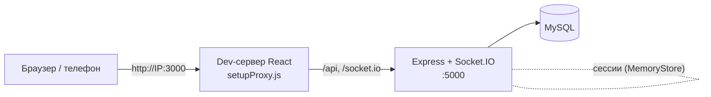
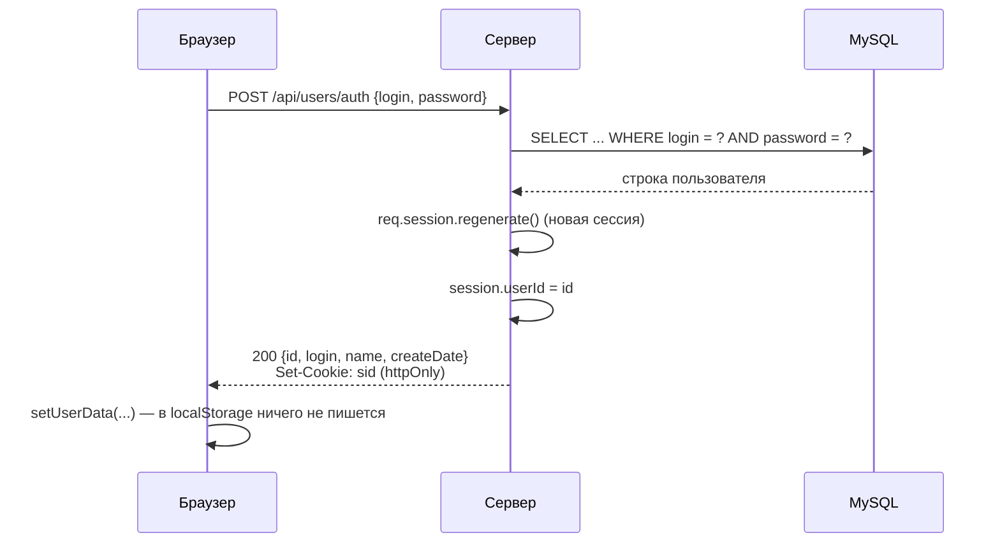
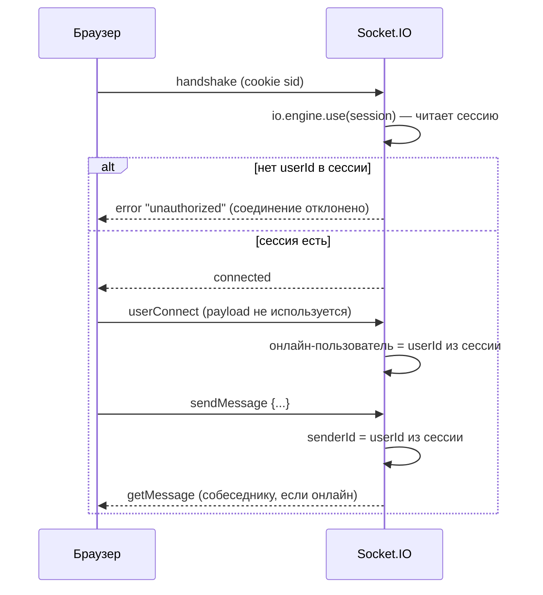

# React Chat

Чат на React с сервером на Node.js/Express, Socket.IO и MySQL.

- `frontend/` — React (Create React App), сокеты через `socket.io-client`.
- `backend/` — Express, Socket.IO, `express-session`, MySQL (`mysql2`).

## Авторизация

### Общая схема

Фронтенд и API работают с одного origin. В разработке `npm start` проксирует
`/api` и `/socket.io` на бэкенд (`frontend/src/setupProxy.js`). Поэтому cookie
сессии — first-party, CORS не нужен, HTTPS не требуется, и приложение открывается
с телефона по IP компьютера в локальной сети.



Браузер получает cookie `sid` (`httpOnly`, `sameSite: lax`, срок 7 дней).
JavaScript её не видит, поэтому XSS не может её украсть. Хранилище
сессий — в памяти процесса: при перезапуске бэкенда все входы сбрасываются.

### Вход



- Пароль хэшируется MD5 без соли (`backend/Controllers/auth`). Это слабая схема,
  планируется переход на bcrypt.
- `regenerate()` создаёт новый идентификатор сессии при входе, чтобы
  украденный до входа `sid` не работал после него.

### Восстановление входа и выход

- При загрузке страницы `App.js` вызывает `GET /api/users/me`. Если cookie
  есть и сессия жива, сервер отдаёт пользователя. Иначе 401 и показывается
  экран входа.
- `POST /api/users/logout` уничтожает сессию и очищает cookie.

### Защита маршрутов

| Маршрут | Доступ |
|---|---|
| `POST /api/users/auth`, `POST /api/users/registration` | публичный |
| `POST /api/users/logout` | публичный |
| `GET /api/users/me` | нужна сессия |
| `GET /api/users` | нужна сессия |
| `POST /api/chats` | нужна сессия; создатель — текущий пользователь |
| `GET /api/chats/:userId` | `:userId` должен совпадать с сессией, иначе 403 |
| `GET /api/chats/find/:a/:b` | текущий пользователь должен быть `a` или `b`, иначе 403 |
| `DELETE /api/chats/:chatId` | только участник чата (проверка в контроллере) |
| `POST /api/messages` | участник чата; `senderId` берётся из сессии |
| `GET /api/messages/:chatId` | участник чата, иначе 403 |

Проверки реализованы в `backend/middleware/requireAuth.js` (нет сессии → 401)
и `backend/middleware/requireChatParticipant.js` (не участник → 403).
Идентичность пользователя никогда не берётся из тела запроса или URL,
кроме проверки совпадения с сессией.

### Сокеты



При переподключении (например, после блокировки экрана телефона) клиент
снова отправляет `userConnect`, а сервер заменяет запись о пользователе.
При возврате вкладки клиент переподключает сокет и заново загружает
открытый чат.

## Запуск

### Backend

1. `cd backend && npm install`
2. Создать `backend/.env`:
   ```
   PORT=5000
   DB_HOST=...
   DB_PORT=3306
   DB_USER=...
   DB_PASSWORD=...
   DB_NAME=...
   SESSION_SECRET=длинная_случайная_строка
   ```
   `SESSION_SECRET` обязателен для постоянных сессий. Без него сервер
   генерирует секрет при старте и выводит предупреждение.
3. `node app.js`

### Frontend

1. `cd frontend && npm install`
2. `npm start`. Прокси на бэкенд: `BACKEND_URL` (по умолчанию `http://localhost:5000`).
   Для доступа с телефона сервер должен слушать сеть (`HOST=0.0.0.0`),
   а телефон открывает `http://IP_компьютера:3000`.

## Структура авторизации

```
backend/
  app.js                              сессии, io.engine.use(session), проверка сокетов
  middleware/requireAuth.js           401 без сессии
  middleware/requireChatParticipant.js 403 для не-участников
  Routes/userRoute.js                 auth, registration, me, logout
  Controllers/auth/main.js            вход, regenerate, запись userId
frontend/
  src/setupProxy.js                   прокси /api и /socket.io (dev)
  src/config.js                       API_URL = '' (тот же origin)
  src/App.js                          восстановление входа через /api/users/me
  src/context/ChatContext.js          сокет создаётся только при входе
```

## Ограничения и план

- Пароли хэшируются MD5 без соли. Нужен bcrypt или argon2, а старые хэши —
  переехать при следующем входе.
- Сессии хранятся в памяти. Для продакшена нужен внешний store (например,
  `express-mysql-session`).
- `secure: false` в cookie: HTTPS пока не используется. Включить `secure: true`
  вместе с HTTPS.
- Регистрация не выполняет вход автоматически.
